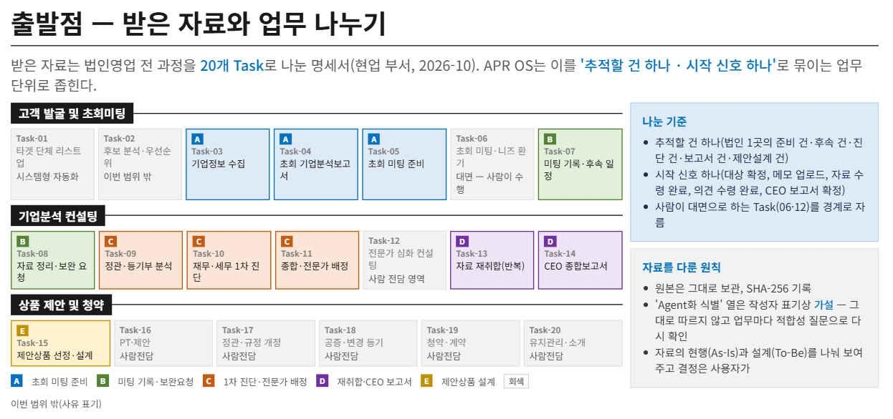

# Entity 결정

출처: GFC Agentic Process 설계 보고(2026-10-15), "출발점: 받은 자료와 업무 나누기" 장표. 이 World는 업무 A\~E(Task-03\~05·07\~11·13\~15)를 법인 딜 하나로 묶는다.

이유 칸의 ①~⑥은 Entity 판단 기준이다. ① 고유한 정체성 ② 여러 단계에 걸친 지속 ③ 의미 있는 상태 ④ 다른 개념과의 관계 ⑤ 행동이 작용함 ⑥ 정책이 가리킴.

## 결정 기록

| 후보 개념 | 최종 분류 | 이유 |
|---|---|---|
| 딜 (Deal) | Entity (주인공) | ①~⑥ 모두. A→E 전체에 걸쳐 지속되고 상태가 바뀐다. 정체성은 corp·gfc 조합이 아니라 `deal_id`로 세운다 |
| 법인 고객 | Attribute (`deal.corp`, `analysis.corp`) | 이 World에서 법인 자체는 상태도, 작용하는 행동도 없다. 정책은 "분석한 법인 = 딜의 법인"(C10)처럼 값을 비교할 때만 쓴다 |
| 업무 건 A~E (PrepCase…ProposalCase) | State (딜의 단계) | 건의 정체성은 판 번호가 있는 산출물 Entity가 대신한다(결정 2) |
| 담당 GFC | Role (`gfc`) + Attribute (`deal.gfc`) | 확정을 하는 주체. "그 딜의 담당자만" 규칙을 위해 담당자를 딜에 기록한다 |
| 부서장 | Role (`dept_head`) + Attribute (`deal.dept_head`) | 기준액 초과 설계안을 결재한다. "그 딜의 부서장만" 규칙(C12)을 위해 딜에 기록한다 |
| 지원부서 | 제외 | 이 World에는 지원부서가 하는 전이가 없다. 딜을 열고 의견 수령을 기록하는 일은 World 밖에서 일어나고, 값(`opinions_received` 등)으로만 들어온다 |
| 준법감시 | 제외 | 하는 일(규칙 변경 승인)이 딜 범위 밖이다 |
| 전문가 | Attribute (`expert_request.experts`) | 요청을 받기만 하고 World 안에서 행동하지 않는다 |
| Agent (업무별 AG-01·02) | Role (`agent`) | 초안 전이만 하고 확정은 못 한다. Agent는 제안하고, 확정은 사람이 한다 |
| 시스템 프로그램 (발송·등록) | Role (`system`) | 외부 효과 전이만 한다 |
| 기업분석보고서 (A) | Entity (`AnalysisReport`) | ①④⑤⑥. 판 번호와 분석한 법인 값이 있다. "분석이 틀렸을 때"라는 이 World의 가장 큰 위험이 여기서 시작된다 |
| 초회 미팅 (Task-06) | Event | 사람이 대면으로 한다. 일어났다는 사실만 B의 전제가 된다 |
| 1차 진단·배정안 (C) | Attribute (`ExpertRequest`에 합침) | 승인한 판과 배정 전문가가 발송에 묶이므로 발송 기록과 함께 둔다 |
| 전문가 배정 요청 (C) | Entity (`ExpertRequest`), 발송은 Effect | ①②⑤⑥. 되돌릴 수 없고 한 번만 보내야 해서 추적이 필요하다 |
| B 상담 기록·보완요청 | State (`followup_received`) | B는 승인이 없고 GFC가 직접 고쳐 보낸다. 딜에서는 수령 확인 하나면 된다 |
| 전문가 의견 | Attribute (`deal.opinions_received`, `deal.opinions_expected`) | 이 World는 의견 수만 비교한다 |
| CEO 종합보고서 (D) | Entity (`CEOReport`) | ①④⑤⑥. 지금 판, 확정한 판, 충돌 조정 근거가 있다 |
| 의견 충돌·조정 근거 | Attribute (`ceo_report.conflicts`, `ceo_report.resolution`) | 값으로 기록하고, "충돌이 있는데 근거가 없으면 확정 불가"는 Constraint로 둔다 |
| 제안 설계안 (E) | Entity (`ProposalDesign`) | ①④⑤⑥. 근거로 한 보고서 판과 연 환산 보험료 합계가 있다. 제안 차수(round)는 이 World에서 다루지 않는다 |
| 설계 시스템 등록 | Event / Effect | 등록 전이의 효과 |
| 연 환산 보험료 합계 | Attribute (`proposal.premium_total`, 원) | 금액별 결재 정책이 가리키는 값 |
| 기준액 | Constraint (식 안의 예시 값) | "기준액 초과 시 부서장 결재" 정책 자체 |
| 승인(확정) | Transition (+ 결과 State, 승인·확정한 판은 Attribute) | 무엇을 승인·확정했는지(`approved_version`, `confirmed_version`)는 남기되 별도 Entity까지는 필요 없다 |
| 판 번호 | Attribute | "D 확정 판 = E가 쓴 판" 대조에 쓴다 |
| 장부·허브·업무 지식(K01~) | 제외 | 허브는 이 World가 대체한다. 장부는 Runtime의 몫이고, 지식은 업무 내부의 일이다 |

## 주인공 Entity

- 주인공 Entity: Deal (법인 딜)
- 왜 이것인가: world-fit 결론에서 1번이 결정적이었다. A→E 내내 다시 돌아오는 대상은 업무 건이 아니라 법인 고객 하나와 그 법인을 맡은 GFC의 딜이다.
